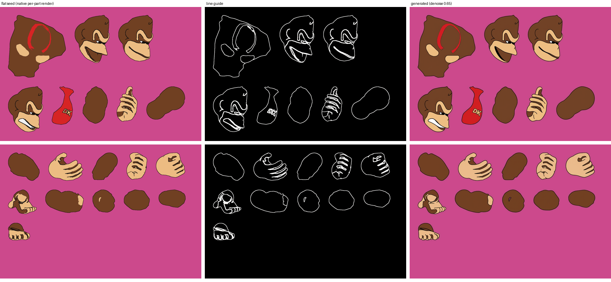
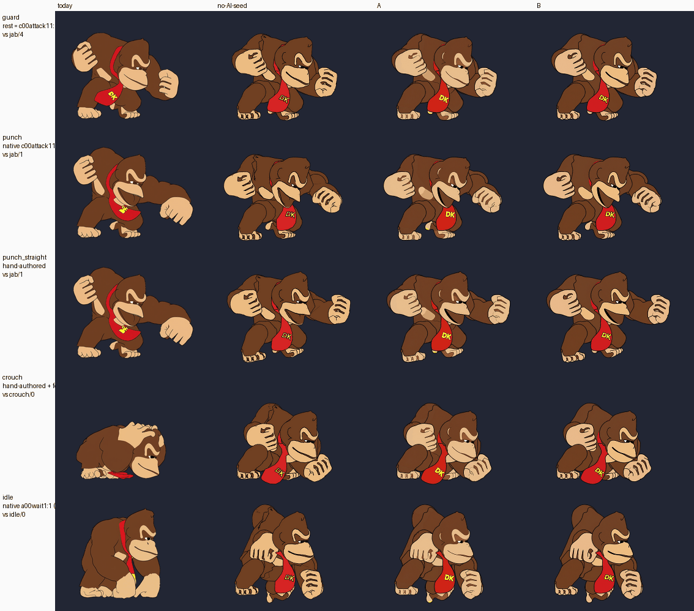
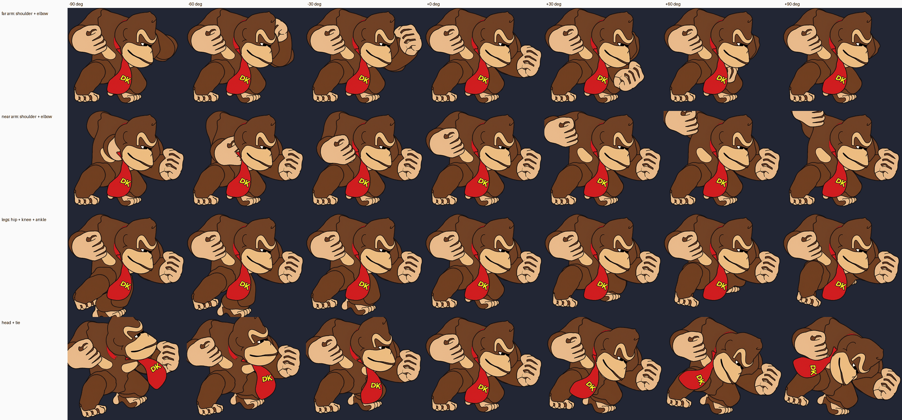
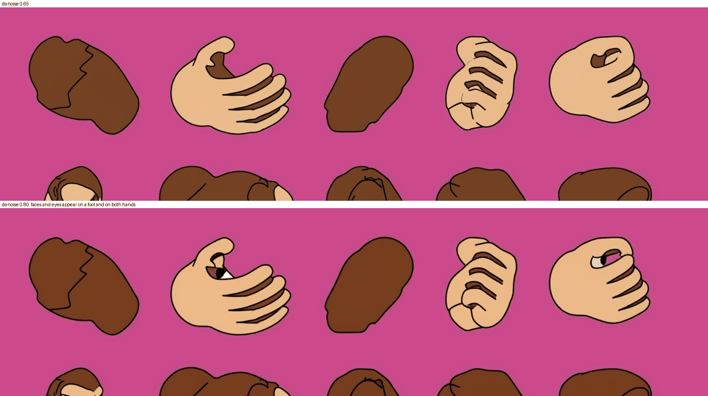
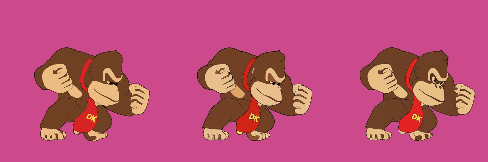

# Phase 3 option: generating cutout parts (Donkey Kong)

2026-10-18. Follow-up to the [skeleton / cutout-parts record](../skeleton/README.md). That record showed the
rig works, but parts cut from today's drawings break: torn shoulders, open outlines, nothing under
overlapping limbs. Question here: can the local pipeline **produce** a consistent set of DK body parts, in
the project's style, ready for a cutout rig?

## Verdict

| | Answer |
| --- | --- |
| Feasible? | **Yes, for one body view.** 19 parts with closed outlines and round joint caps, in today's style, made without any pixel edits |
| Approach that worked | **B**: render each body part of the native DK mesh alone, lay the parts out on two sheets, and repaint the sheets with today's img2img recipe (denoise 0.65) |
| Cost | About 2.5 min CPU + about 70 s GPU for the whole set |
| Joint quality | No gap at any joint across ±90° (every child covers a full disc around its pivot) |
| Consistency | One sampling pass paints all parts. Seed 2 differs from seed 1 by 0.034 (mean per part, 0..1) |
| Still needs a human | Review, picking the rest pose and variants, per-pose draw-order changes, posing, and extra body views (below) |

The part set is in `.tmp/rig/donkeykong-parts/` (`parts.json` + 19 PNGs + `test-poses.json` + a README).

## How the parts are made

The key step is the native DK model in `assets/gen/dk-native-reference/`, which today's art pipeline
already uses for its guides. A skinned mesh already "knows" its parts.

1. **Per-part native render** ([scripts/native_parts.py](scripts/native_parts.py)). Pose the mesh at the
   jab guard (`c00attack11` sample 18, the source of today's `jab/4`). Give every triangle to the part whose
   bones carry most of its skin weight. Render each part **alone** with the material classes and line
   guides of `tools/dk-material-guide.py`. A part rendered alone has no occluder, so the hidden areas come
   for free. Variants use the same pose:
   - heads swap the facial meshes (`HeavyAttack+FaceUP6` = shout, `Attack2+FaceUP6` = grit);
   - open hands take the finger bones of `g01cliffcatch` sample 5.
2. **Shapes** ([scripts/shape_parts.py](scripts/shape_parts.py)):
   - add a round disc at every joint (the overlap cap), sized from the limb thickness;
   - smooth the jagged triangle cuts;
   - fill the cap with the part's own nearest material;
   - drop mesh-crease lines on plain limb segments and the torso;
   - pack all parts on two 1536×1024 sheets (flat seed, line guide, mask).

   The draw order comes from the whole-body z-buffer: for each overlapping pair, the part the native render
   shows in front wins.
3. **Generate** ([scripts/gen.py](scripts/gen.py)): masked img2img with Z-Image Turbo int8 and the Fun
   ControlNet Union. This is the graph of `rework-2026-10-10/art/dk-run-job.py` (cfg 1, 8 steps, strength
   1.0, denoise 0.65, seed 2026101001). The prompt is in [scripts/prompt-B.txt](scripts/prompt-B.txt).
4. **Post** ([scripts/post_parts.py](scripts/post_parts.py)):
   - key out the magenta, keeping only what lies inside each planned shape plus 10 px;
   - ink a 4 art-px outline ring wherever the generator left none;
   - downscale by 0.3653 to drawing resolution (art px → source px);
   - write `parts.json` with the pivots, child joints, parents and draw order.

## The two approaches

- **A, model sheet then cut** ([scripts/a2_sheets.py](scripts/a2_sheets.py)): generate the whole body in
  the guard pose with today's recipe, cut it with the native per-pixel part map, then inpaint the hidden
  areas and cut borders on the part sheets.
- **B, parts generated directly**: steps 1–4 above. The whole sheet is repainted once.

Both use the same shapes, rig and post-processing. A also needs the whole-body render.

| | A: whole body, cut, inpaint | B: part sheets directly |
| --- | --- | --- |
| GPU renders | 3 (1 whole body + 2 sheets) | 2 sheets |
| GPU time (8 GB laptop GPU) | 57 s + 28 s + 28 s | 38 s + 26 s |
| Share of part area that could be reused from the whole-body render | 40 % overall; upper arms 4–19 %, far shin 6 %, open hands 0 % | n/a |
| Outline edge already inked by the generator | 99.8 % (min 96 %) | 100 % (every part) |
| Faults seen | Seams where reused and inpainted pixels meet (torso skin patch, softer outline); a yellow fleck of the tie lettering pasted onto a foot | Folds the generator invents on the torso back; no seams |
| Manual pixel fixes | none | none |

A brings little. The guard pose hides most of each limb, so A inpaints most of the limb area anyway. Where
it does reuse pixels, the reused and repainted areas do not match. **B is the recommended path.**

Shared CPU cost: native per-part renders 100 s (one thread), shapes and packing 54 s, post-processing
under 1 s, each test pose under 1 s.

Parts and rest pose (2×; red = pivot, blue = child joints): [parts-contact-B.png](parts-contact-B.png),
and for comparison [parts-contact-A.png](parts-contact-A.png).

## Test poses beside today's drawings

Columns: today's drawing, the flat native seed with no generation, A, B. Match size (0.467 × zoom 1.4):

At 2×, A against B: [poses-A-B-x2.png](poses-A-B-x2.png).

| Pose | Made how | Result |
| --- | --- | --- |
| guard | rest pose (all angles 0) | Reads like today's `jab/4`. Clean joints |
| punch | angles from the native frame (`c00attack11` 5): each limb's joint-to-joint direction | Far arm extends correctly. The near fist sits too low: in 3D that forearm points at the camera, and a rigid 2D part cannot shorten |
| punch_straight | hand-set angles (5 numbers) | Reads as a punch. Today's `jab/1` punches with an arm drawn in front, which is another view |
| crouch | hand-set torso, head and arms + a feet-planting IK ([scripts/ik.py](scripts/ik.py)) | Plausible low guard. Today's crouch turns the body to the front, which one view cannot do |
| idle | angles from the native frame (`a00wait1` 1) | Fails as expected: DK faces the camera in idle, a different body view |

Joint stress (limbs swung −90° to +90°): no gap opens at any joint.

## Numbers (B)

| Measure | Value |
| --- | --- |
| Parts | 19: torso, tie, 3 heads, and per side upper arm, forearm, fist, open hand, thigh, shin, foot |
| Opaque pixels | 105.7 k |
| Pixels in part rectangles | 204 k ≈ 199 KiB BC7 at drawing resolution, ≈ 0.8 MiB at Final 2× |
| Joint coverage at 80 % of limb half-width | ≥ 0.999 for every joint ([joint-coverage-B.json](joint-coverage-B.json)) |
| Seed sensitivity (seed 2026101002 vs 2026101001) | 0.034 mean premultiplied RGB difference per part, worst 0.078 (far foot) |
| Share of opaque pixels inside the fur recolour region (`#704023`) | 0.61 (today: `jab/4` 0.59, `idle/0` 0.64): recolours like today's art |
| Outline at drawing resolution | about 1.5 px (4 art px ring), slightly heavier than today's |

For comparison, today's DK uses 158 MiB of drawings. This one view of parts is under 1 MiB even at Final
resolution.

## Failure modes found

- **Too much freedom invents faces.** At denoise 0.80 the model drew a face on a foot and an eye on both
  hands. At 0.65 it never did. Keep part sheets at ≤ 0.65.

  

- **Whole-body seed drift.** The second seed of the whole-body render (approach A) changed the face style
  (big white eyes). Part sheets were stable across seeds.

  

- **Mesh artefacts reach the seed.** Raw per-part renders carried jagged triangle cuts and crease lines that
  the generator copied (v1). Fixed in code: joint discs, smoothing, a torso-only opening, and no crease ink
  on plain segments (v2).
- **The torso shows mesh skin classes** (two tan patches, the tie's collar ring) when an arm or the head
  swings far away. Today's art has no chest patch, but the generation prompt asks for one. Decide whether
  to reclassify them as fur.

## What still needs a human

Nothing in this run was edited by hand at pixel level. The human or one-time decisions were:

| Decision | Time here | Repeats per |
| --- | --- | --- |
| Bone-to-part table (from the skeleton bone names) | ~15 lines, once | body type |
| Rest pose (jab guard) | one choice | view |
| Expression meshes and open-hand source, picked from contact sheets of 8 candidates each | ~5 min | character |
| Three shape rules added after inspecting v1 (own-material caps, no limb creases, torso smoothing) | now code | – |
| Review of the sheets and posed results | ~5 min | part set |
| Poses and per-pose draw-order changes (e.g. an arm across the chest) | per move | move |

## Limits and next steps

1. **One body view only.** Today's idle and crouch show DK facing the camera, and turns need a back view.
   The same pipeline can make a second view from another native frame, for example `a00wait1`. Estimated
   cost is about 3 min CPU + 1 min GPU per view. Not tried here.
2. **Foreshortening.** Limbs that point at the camera need a variant part (a short "pointing" forearm) or a
   correction drawing.
3. **Characters without a native mesh** would need part shapes from somewhere else, such as a template
   mannequin. Not tested. Link and Pikachu have native references in `assets/gen/`, so the same path
   applies to them.
4. **Posing from UFD/native motion.** Joint-vector angles work for limbs in the same view. Combine them with
   the skeleton record's automatic fit for twisted torsos.

## Files

- [scripts/](scripts/): every script and the prompts. Paths point at the session scratch folder. Run the
  Python with `~/ComfyUI/.venv/bin/python` (needs scipy and ssbh_data_py).
  - [gpu_session.sh](scripts/gpu_session.sh): takes `.tmp/dk-heavy.lock`, waits for free GPU memory,
    starts ComfyUI, runs a jobs file, then stops ComfyUI by PID.
- Images: [pipeline-sheets.png](pipeline-sheets.png), [parts-contact-B.png](parts-contact-B.png),
  [parts-contact-A.png](parts-contact-A.png), [poses-all-match.png](poses-all-match.png),
  [poses-A-B-x2.png](poses-A-B-x2.png), [joint-stress-B.png](joint-stress-B.png),
  [denoise-failure.png](denoise-failure.png), [a-wholebody-renders.png](a-wholebody-renders.png).
- Part set: `.tmp/rig/donkeykong-parts/` (git-ignored).
- No game code, `character/` source or `assets/` file was changed, and nothing was committed.
- Operational note: a bug in the first version of the session script left one ComfyUI process running
  and holding the GPU lock for about 17 minutes (20:36–20:53). It was stopped by PID, and the script now
  stops ComfyUI by its own PID.
