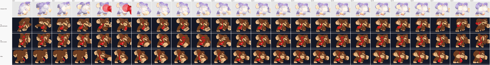

# Phase 3 option: a cutout rig in the package, the evaluator and the lab

2026-10-18. Follows the [skeleton exploration](../skeleton/README.md), which showed
the idea on DK's jab with hand-cut parts. This step makes it real: the rig is part
of `character-package/1`, the evaluator poses it, the lab draws it, and DK's jab
and idle are rig actions fitted automatically.

## Result

| | Answer |
| --- | --- |
| Format | Works. A package can hold a rig; drawn and posed actions coexist; a slot swaps between alternative parts on any key |
| Memory | DK's whole generated part set is **0.20 MiB BC7** (19 parts, one 284×744 page). Today's jab alone is 0.43 MiB, idle 0.60 MiB. Pose data: 0.3–4.5 KiB per action |
| Look | Reads as DK in motion at match size. Better silhouette match to Ultimate than today's jab on most ticks; clearly worse on the wind-up (torso twist) and nothing like as rich as hand drawings |
| Missing | Forward smash (fitter supports it, run stopped for time), other views, item socket on the generated set, game renderer |

Two candidates are served by the lab:

| Package | Parts | Posed actions | Other actions |
| --- | --- | --- | --- |
| `donkeykong~rig` | The generated set (`.tmp/rig/donkeykong-parts`, [parts record](../parts-generation/README.md)): 15 bones, 19 parts, variants head ×3, hands fist/open | `jab` fitted to Ultimate; `idle` hand-keyed (below) | Today's drawings, unchanged |
| `donkeykong~rig-v2` | The hand-cut parts of the [skeleton exploration](../skeleton/README.md) plus an idle body and head cut from `idle/0`: 4 bones, 9 parts | `jab` fitted to Ultimate; `idle` fitted to today's idle drawings | Today's drawings, unchanged |

Action ids are kept (`jab`, `idle`), so the lab's Ultimate recording and the compare pane
(`donkeykong`, today) line up on the same id. Package id stays `donkeykong`.

## How the poses were made

`tools/rig-pose-fit.py` (PyTorch). It reads the rig from the package itself and renders it
with the evaluator's exact transform rules (checked against `evaluate()` to 5 decimals).
Gradient descent fits every bone's angle (and offsets where allowed) per frame:
- **jab**: the 24 frames of Ultimate's jab 1 (UFD). Silhouette and skin-coloured areas only,
  since the costume differs. Hitbox bubbles count a third: the punching fist is under them.
  Generated set: only the torso may move; limbs turn and scale by at most 20%.
- **idle, hand-cut**: today's 11 idle drawings (there is no Ultimate idle recording).
- **idle, generated**: the generated set is the 3/4 fighting view and today's idle is a
  profile view, so fitting contorted it. Instead: a 4-key breathing loop (smooth ease)
  around the idle pose the parts author derived from Ultimate's native `a00wait1`.

Per-frame fits are noisy (a forearm can flip to an equally good solution for one frame).
Each channel is then smoothed (median of three, then [1, 2, 1] / 4), a switch cost keeps
look-alike variants from flickering, and keys are dropped where linear interpolation
reproduces them within 3°, 1.5 design px and 3% scale.

| Action | Keys | Of ticks | Note |
| --- | ---: | ---: | --- |
| jab, generated | 23 | 24 | Ultimate's jab changes pose every frame; few keys can go |
| jab, hand-cut | 21 | 24 | |
| idle, generated | 4 | 140 | Hand-keyed loop |
| idle, hand-cut | 9 | 140 | Fitted to today's 11 drawings |

Silhouette overlap with the registered Ultimate frame (shared ÷ combined area, per-frame
fit, bubbles included in the target): generated set mean **0.81** (0.75–0.87), hand-cut
0.78 (0.70–0.86). The skeleton exploration measured today's drawings at 0.40–0.64 against
the same frames, partly from placement.

## Memory

From `character/package/memory.ts` (BC7 = 1 byte per pixel of the page; pose data as
32-bit values).

| | Drawings or parts | Drawn pixels | BC7 | Pose data |
| --- | ---: | ---: | ---: | ---: |
| jab, today | 7 drawings | 426 k | 444 KiB | 0 |
| jab, generated rig | 16 of 19 parts | 142 k | 206 KiB (the shared part page) | 4.5 KiB (19 KiB as JSON) |
| jab, hand-cut rig | 7 of 9 parts | 128 k | 222 KiB (shared) | 1.9 KiB |
| idle, today | 11 drawings | 551 k | 610 KiB | 0 |
| idle, generated rig | 15 parts | 128 k | 206 KiB (shared) | 0.3 KiB |
| idle, hand-cut rig | 2 parts | 60 k | 222 KiB (shared) | 0.6 KiB |
| Whole package | | | today 169.5 MiB → 168.7 MiB | 5.2 KiB |

The part page is paid once for every posed action. With jab and idle posed, the package
loses 2 pages (1.05 MiB) and gains one (0.20 MiB). Every further posed action costs only
its keys (a few KiB), as long as the existing parts can show it.

## How it looks

Jab, all 24 ticks at match size (0.467 × zoom 1.4). Rows: Ultimate as registered for the
fit, rig with generated parts, rig with hand-cut parts, today. Rig and today rows are the
lab's own canvases captured in Edge:



Selected ticks at 2×: [jab-x2.png](jab-x2.png). Idle every 8th tick:
[idle-ticks-match.png](idle-ticks-match.png). Lab views:
[generated jab with skeleton](lab-generated-jab-skeleton.png),
[generated idle in costume 2](lab-generated-idle-costume-2.png),
[hand-cut jab with skeleton](lab-handcut-jab-skeleton.png).

Honest reading:
- **Generated parts read as one character.** Closed outlines and joint caps hide the
  seams that ruined the hand-cut set. At match size the limbs look attached.
- **Motion follows Ultimate** from tick 4 on: punch out under the hitbox, recoil, guard,
  return. It moves on every tick, where today's jab holds 7 drawings.
- **The wind-up (ticks 0–3) is wrong.** Ultimate twists the torso and brings the far fist
  across the face. One rigid torso in one view cannot twist; the fit bends the body over
  instead. This needs another torso view or a correction drawing.
- **It is flatter than today's art.** No foreshortening, no squash, the same face drawing
  turned. Today's drawings have more life but a back view at tick 0 that Ultimate lacks.
- **Small faults:** the tie flips up at the end of the jab; hidden limbs sometimes sit at
  odd angles because nothing in the target constrains them.
- **Hand-cut parts** show the old problems: open flanks, pasted fists, a squeezed head.
- **Idle:** the hand-cut loop follows today's breathing closely (same view). The generated
  loop is the guard view breathing; it is not DK's real idle.

## What is missing

- **Forward smash.** The fitter handles it (open-hand variants, larger canvas, registered
  Ultimate frames); the run was stopped to deliver on time. About 25 minutes on the GPU.
- **Other views and foreshortened limbs** (next part step). The format already swaps a
  slot's part per key, and each variant carries its own pivot.
- **Item socket for the generated set**: its `parts.json` has none; `rig.sockets` exist
  and work (the hand-cut set carries one on the arm bone).
- **Game renderer**: one dynamic quad batch per fighter (see the skeleton record).
- Interpolation is on whole ticks (the evaluator floors ticks as before).

## View it

`npm run lab`, then open `http://localhost:5180/?package=donkeykong~rig&action=jab&compare=donkeykong`
(or `donkeykong~rig-v2`). Tick **Skeleton** under Overlays. Rebuild:

```
npm run character:rig -- donkeykong --parts .tmp/rig/donkeykong-parts/parts.json --poses <poses.json>
```

Pose files and the fit runs are in [scripts/](scripts/) (`run_fits.sh`, `gen_idle.py`).

## Format

All additions are optional, like costumes were. A package without `rig` is
unchanged. Types: `character/package/types.ts`; checks: `validate.ts`.

**Rig** (`pkg.rig`):

| Field | Meaning |
| --- | --- |
| `bones.<id>` | `parent` (absent for the one root bone), rest `x`, `y` (design px, in the parent's frame) and `angle` (degrees, clockwise) |
| `slots.<id>` | `bone`, draw order `z` (lower is further back), `drawings`: the variants that may fill it; the first is the default |
| `sockets.<name>` | `bone`, `x`, `y` in the bone's frame, optional item `angle` |

A part is an ordinary `Drawing` on an ordinary page. Its `anchor` is the point
pinned to its bone's origin, so the memory estimate, packing and costumes treat
parts like any drawing.

**Posed action.** An action has either `drawings` (today) or `pose`, never both:

| Field | Meaning |
| --- | --- |
| `pose.length`, `pose.after` | Ticks, and `loop` / `hold` / `stop` as for drawing schedules |
| `pose.keys[]` | Ascending `tick`, the first at 0 |
| `key.bones.<id>` | Change from rest: `angle`, `x`, `y` (added), `sx`, `sy` (multiplied). Missing = rest |
| `key.ease` | How bone channels move to the next key: `linear` (default), `smooth` (3u² − 2u³) or `step` |
| `key.show.<slot>` | Another of the slot's drawings, or `null` to hide it. Missing = the slot's first drawing |
| `key.z.<slot>` | Another draw order while this key holds |
| `key.drawing` | A full drawing shown instead of the parts until the next key: the correction drawing |

Rules, chosen to keep evaluation simple and seekable:
- Bone channels interpolate between consecutive keys by the earlier key's ease.
  Angles interpolate as plain numbers, so a key may turn a bone past half a turn.
- `show`, `z` and `drawing` switch on the key's tick (cutout swaps). They are
  relative to the slot defaults, not carried from earlier keys, so any tick can
  be evaluated from two keys only.
- `loop` eases from the last key back to the first at `length`. `hold` and `stop`
  keep the last key until `length`.
- A posed action's sockets come from the rig's bone sockets. Socket tracks on the
  action still work and override them by name.

**Mixing.** Drawn and posed actions sit side by side in one package, sharing pages,
costumes and memory accounting. Inside a posed action, a key with `drawing` shows a
correction drawing for the poses the rig cannot make.

## Evaluator

`evaluate()` is unchanged for drawn actions. For posed actions it returns
`rig: { key, parts, bones }` (`character/evaluator/rig.ts`):
- `parts`: back to front, each with an affine transform from the drawing's page
  pixels to root space (design px), facing applied;
- `bones`: each bone's origin in root space, for the skeleton overlay;
- `drawing`: the correction drawing while one is shown, otherwise null;
- sockets: the rig's bone sockets in root space, mirrored for facing left.

Bone transform: parent · translate(rest + offset) · rotate(rest + angle) ·
scale(sx, sy). Part transform: mirror · bone · scale(drawing scale) ·
translate(−anchor). Pure and deterministic; ticks are floored as before.

## Lab

The main and compare panes draw drawn and posed actions through one path: every
layer (a full drawing or a part) is placed by its transform. Costumes recolour each
part through the existing GPU recolour. New overlay **Skeleton** draws bones and
joints; **Drawing bounds** outlines each part. The timeline strip shows pose keys
for posed actions. The action panel lists keys, bones and slots; the memory panel
adds pose data.

## Files

| File | What |
| --- | --- |
| `character/package/types.ts`, `validate.ts` | Rig and pose track types and checks |
| `character/package/usage.ts` | `actionDrawings` (what an action shows, drawn or posed) and `withoutUnused`, shared by validation, memory and both candidates |
| `character/package/memory.ts` | Counts parts per action and pose data (`poseBytes`) |
| `character/evaluator/rig.ts`, `evaluate.ts` | Posing, `actionSpan`, `tickWithin` |
| `character/lab/stage.ts`, `main.ts` | Drawing parts, skeleton overlay, key strip |
| `character/candidates/rigParts.ts` | Reads a part set (`rig-parts/1`, or the generated `dk-cutout-parts/1`) into bones, slots and part drawings |
| `character/candidates/rigCandidate.ts` | `npm run character:rig`: writes `<id>~rig` |
| `character/candidates/pixels.ts` | `writePage`, the shelf packer, now shared by repack and the rig page |
| `tools/rig-pose-fit.py` | The pose fitter (PyTorch) |
| `tools/character-lab-probe.mjs` | Two rig views added |
| [scripts/](scripts/) | Lab frame capture (`lab-capture.mjs`), strips (`strips.py`), fit runs, the generated idle loop, the hand-cut part script |
| [poses/](poses/) | The pose files both packages were built from |
