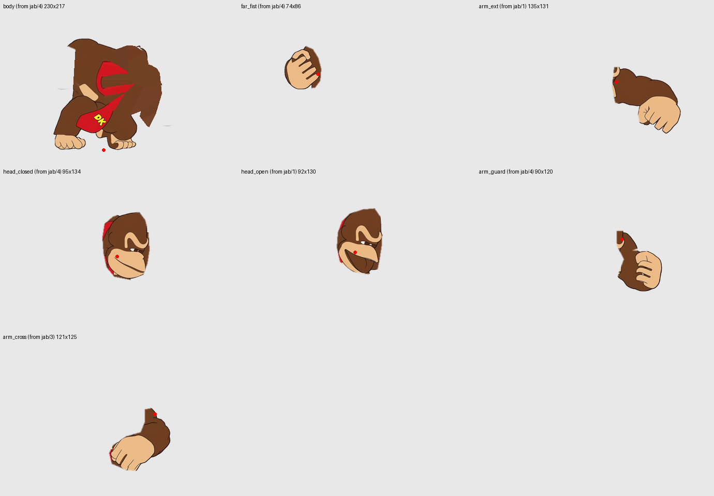
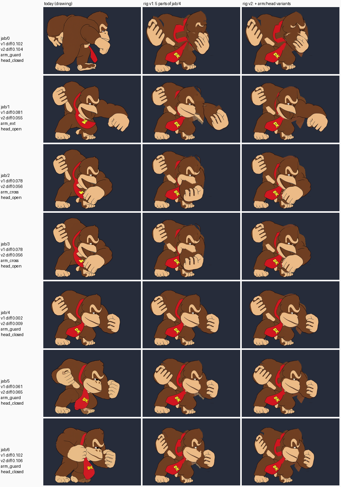
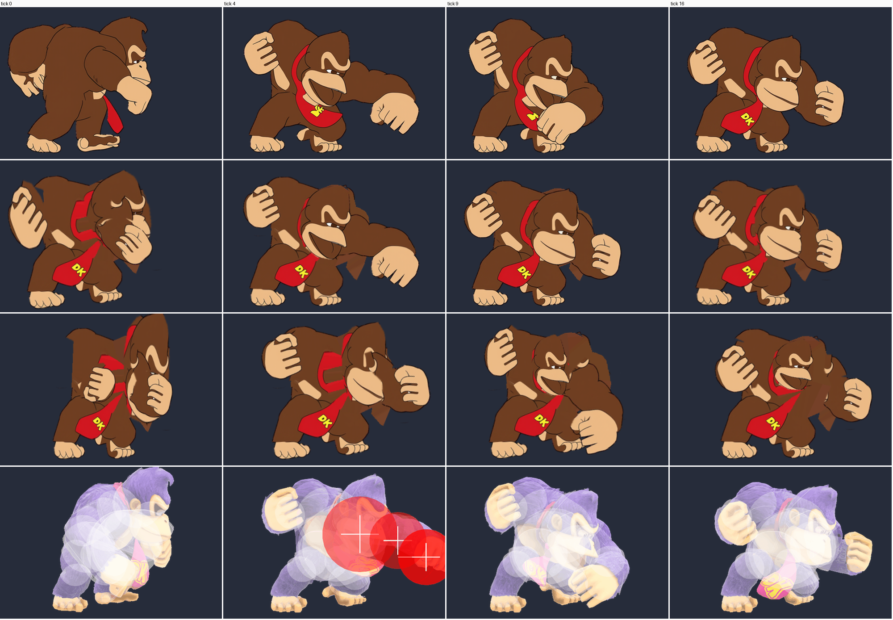

# Phase 3 option: skeleton / cutout-parts rendering

2026-10-18. One of the Phase 3 explorations in the
[Phase 3 record](../../README.md). Question: can a character be drawn from a small
library of body parts moved by a 2D skeleton (a "cutout rig"), with full drawings
kept only where the rig fails, and what would that save?

Words used here:
- **Part**: a small picture of one body piece (head, fist, arm), with a pivot.
- **Rig**: the parts plus a tree of joints. Each tick sets an angle, offset and
  scale per part.
- **Variant**: another picture for the same slot (fist seen from the back or the
  knuckles, open or closed mouth). The rig swaps it in, as cutout animation does.
- **Correction drawing**: a full drawing kept for a tick the rig cannot make.
- **diff**: the Phase 3 drawing difference (`signatureDiff`, premultiplied RGBA
  on a 4 design-px grid, 0..1). For scale: consecutive drawings of an ordinary
  move differ by about 0.2; the user accepted 0.12 for held Final drawings.

## Verdict

| | Answer |
| --- | --- |
| Memory | The parts themselves are almost free: about 0.2–0.6 MiB per fighter (2.4 MiB for DK at Final resolution). The total is set by the correction drawings. 10× needs at most ~9% of today's drawings kept; 5× allows ~20% |
| Quality | High risk if parts are cut from today's drawings (seen below). Plausible if parts are drawn for it on purpose. Turns, foreshortening and squash/stretch still need drawings |
| Effort | Renderer and format: small. Generating consistent part sheets with the pipeline: the real, unproven work |

The rig is the only option looked at so far whose memory does not grow with
the number of drawings: a 20th move costs pose data (kilobytes), not pixels.
It is an order of magnitude only if most moves avoid correction drawings, and
that depends on the art being made as parts from the start.

## 1. Prototype on DK's jab

Move: DK `jab` (24 ticks, 7 drawings, 426 k drawing pixels ≈ 0.42 MiB BC7).
Scripts are in [prototype/](prototype/) (paths point at a scratch folder).

**Cutting parts.** First try: split the drawing into regions along its dark
outlines. It failed: the generated art's outlines are not closed, so the fill
leaked into 29 regions, 4 of them large (body, hands and legs merged). Parts were
then cut with hand polygons (about 15 points each, a few minutes per part). The
hole a part leaves in the body was filled with the nearest fur colour. That is
what a generator would have to paint properly.

**Two rigs.**
- v1: one drawing (`jab/4`, the guard) cut into 5 parts: body (with legs and
  tie), far fist, head, near upper arm, near forearm+fist.
- v2: the v1 body and far fist, plus variants cut from other jab drawings:
  near arm *guard* (`jab/4`), *extended* (`jab/1`), *across the chest*
  (`jab/3`); head *closed* (`jab/4`) and *open mouth* (`jab/1`).

| Part (v2) | Cut from | Size (source px) | Pixels with alpha |
| --- | --- | --- | ---: |
| body | jab/4 | 230 × 217 | 31,556 |
| far fist | jab/4 | 74 × 86 | 4,694 |
| arm guard | jab/4 | 90 × 120 | 6,852 |
| arm extended | jab/1 | 135 × 131 | 10,305 |
| arm across | jab/3 | 121 × 125 | 7,939 |
| head closed | jab/4 | 95 × 134 | 10,358 |
| head open | jab/1 | 92 × 130 | 9,567 |
| **total** | | 131.8 k px in rectangles (62% filled) | 81,271 |

So the whole jab library is **129 KiB in BC7, 3.3× less than the move's 7
drawings**, and it would be reused by every move with the same body view.

**Posing.** The poses were found automatically. A small differentiable renderer
(PyTorch: each part is warped by its joint transforms and layered) is compared
with the target picture, and gradient descent adjusts every joint angle, offset
and scale. It starts from several arm angles and every variant pair, and keeps
the best. About 2 minutes per frame on 2 CPU threads.

**Fit to today's drawings** (diff, lower is closer; "no rig" is the guard
drawing shown unchanged):

| Drawing | What it shows | no rig | v1 | v2 (variant chosen) |
| --- | --- | ---: | ---: | --- |
| jab/0 | DK seen from behind | 0.222 | 0.102 | 0.104 (cannot: different view) |
| jab/1 | punch, arm extended | 0.167 | 0.081 | **0.055** extended + open |
| jab/2, jab/3 | fist across chest | 0.176 | 0.078 | **0.056** across + open |
| jab/4 | guard (the source) | 0 | 0.002 | 0.009 |
| jab/5 | far fist lowered | 0.119 | 0.061 | 0.065 guard + closed |
| jab/6 | hands to face | 0.168 | 0.102 | 0.106 (no variant for this far arm) |

Twice the match size, to see the joins: [fit-v1-v2-x2.png](fit-v1-v2-x2.png).

What the images show:
- **v1 (rotate pieces of one drawing) does not work.** Rotating the bent guard arm
  does not give a punch: the fist floats beside a torn shoulder, and the fist
  pasted on the face for jab/2–3 has no forearm. Visible even at match size.
- **v2 (swap in a few variants) reads correctly** for the punch and the
  across-chest frames. The remaining faults are all from cutting finished art:
  the flank where the arm was removed has no outline, a wedge of the old arm
  shows under the punch, and the tie never swings.
- **jab/0 (back view) and jab/6 (both hands up)** need either another body view
  or another far-arm variant, or a correction drawing. jab/0 is also a
  consistency fault of today's art: Ultimate's jab starts in the same front view.
- **Every tick can now be a new pose** at no memory cost. Today's jab shows 7
  drawings over 24 ticks; the rig interpolates the joints between them.
  Swaps between variants still happen on one tick.

**Posed to the Ultimate recording.** The same v2 rig was fitted to 10 frames
of Ultimate's jab 1 (UFD GIF, one frame per tick). Ultimate is a 3D render with
a different costume, so the fit compares only the silhouette and the skin-coloured
areas (fists, face, feet). The red hitbox bubbles are ignored. Ultimate DK is
scaled by 0.755 and his feet put on the root.

| Tick | 0 | 2 | 4 | 5 | 7 | 9 | 12 | 16 | 20 | 23 |
| --- | ---: | ---: | ---: | ---: | ---: | ---: | ---: | ---: | ---: | ---: |
| Silhouette overlap, rig vs Ultimate | 0.85 | 0.82 | 0.83 | 0.78 | 0.90 | 0.90 | 0.91 | 0.90 | 0.88 | 0.89 |
| Today's drawing vs Ultimate (not re-aligned) | 0.46 | 0.46 | 0.48 | 0.40 | 0.64 | 0.57 | 0.51 | 0.51 | 0.56 | 0.55 |

(Overlap = shared area / combined area of the two silhouettes. Today's drawings
are shown where the game puts them, so the second row partly measures placement,
not pose.)

All 24 ticks at match size, rows today / rig every tick / rig posed to
Ultimate / Ultimate: [jab-ticks-match.png](jab-ticks-match.png). These crops of
Ultimate frames are the same kind as the lab screenshots already kept in
[character-lab](../../../character-lab/README.md).

- Where the library holds the pose (ticks 9–23: low fist, guard), the fitted rig
  follows Ultimate's fist positions and silhouette better than today's drawings.
- Where it does not (ticks 0–2: Ultimate winds up with the near fist in front of
  the face and the torso twisted), the fit breaks: the head is squeezed and the
  fist sinks into the body. A single rigid body part cannot twist.
- At the hit (ticks 4–5) Ultimate's arm is hidden under the hitbox bubbles, so
  the fit there is a guess.
- The fit is automatic, unattended and needs no labelled joints. Turning the
  Ultimate recordings into pose tracks this way is a real asset for a pipeline,
  whatever the parts look like.

## 2. Memory

BC7 stores 1 byte per pixel. A rig's GPU cost is its parts library plus any full
drawings it keeps. Its pose data is CPU-side and small.

**Model.** One full set of parts for one view = the body's visible area
(median non-empty pixels of a non-Final drawing) × 1.3 for hidden areas painted
under overlaps and joint caps ÷ 0.6 for rectangle filling (the prototype
measured 0.62). Five views (3/4 front, profile, 3/4 back, front, back; left
facing is a mirror), plus 50% for hand shapes, head angles × expressions, feet
and accessories. Kept drawings cost their share of today's package.

| | DK | Link | Pikachu |
| --- | ---: | ---: | ---: |
| Today, BC7 (repacked) | 158.1 MiB | 70.9 MiB | 63.9 MiB |
| Median body pixels per drawing | 39,130 | 13,919 | 10,727 |
| Parts library, match resolution | 0.61 MiB | 0.22 MiB | 0.17 MiB |
| Parts library at Final zoom (2× size) | 2.4 MiB | 0.9 MiB | 0.7 MiB |
| Pose data, a key every tick (20 joints, 12 B) | 1.9 MiB | 2.3 MiB | 1.4 MiB |

Total with Final-resolution parts, by share of today's drawings kept as
correction drawings ([memory-model.json](memory-model.json)):

| Drawings kept | DK | Link | Pikachu | Factor |
| --- | ---: | ---: | ---: | ---: |
| 5% | 10.3 MiB | 4.4 MiB | 3.9 MiB | 15–17× |
| 10% | 18.2 MiB | 8.0 MiB | 7.1 MiB | 8.7–9.1× |
| 20% | 34.0 MiB | 15.0 MiB | 13.4 MiB | 4.6–4.8× |
| 30% | 49.9 MiB | 22.1 MiB | 19.8 MiB | 3.2× |
| Finals kept whole + 10% elsewhere | 71.9 MiB | 12.4 MiB | 41.6 MiB | 1.5–6× |

What follows from this:
- The factor is roughly 1 ÷ (share of drawings kept). The library itself never
  matters: even 3× the model's guess for views and variants stays under 8 MiB.
- Finals decide the outcome for DK and Pikachu (39% and 61% of their pixels).
  If Finals stay as full drawings the saving is only 1.5–2×. Finals would need
  their own parts at Final resolution (still under 3 MiB) and their cinematic
  shots planned as rig poses.
- Kept drawings combine with the other Phase 3 savings (holds, non-empty tiles,
  BC7), and a correction can often be a partial drawing (a torso turning, a
  smeared arm) layered with rig parts instead of a whole body.
- For the prototype move alone: 7 parts in 129 KiB against 7 drawings in
  0.42 MiB, with no reuse from other moves counted.

## 3. Feasibility for the pipeline

**What creation would have to produce**, per character:
1. A model sheet per view (five views), drawn as separate layers: each part
   complete, including what other parts hide, with overlapping joint caps
   (round ends that cover the seam when a joint bends). Closed outlines per part.
2. Variant sheets: hand shapes (fist, open, grab, point) in 2–3 orientations;
   heads per view × a few expressions; tie/hair/cape pieces with 2–3 swing
   states.
3. A rig per view: pivot positions and a parent tree, from a template per body
   type (biped, quadruped, Pikachu-like) and checked by a person.
4. Per move: a pose track. The prototype shows this can be fitted automatically
   to Ultimate recordings once the parts exist, then reviewed.
5. Correction drawings where the fit error stays high. The rig render of the
   fitted pose is a ready-made pose guide for ComfyUI, which keeps the
   correction on-model.

Today's pipeline makes whole drawings. Getting the same character, in the same
style, as consistent layered parts across five views is the step nobody has
shown yet. It is the main risk. The art direction helps: clean flat cartoon with
bold outlines is the style cutout animation is normally used for. Brawlhalla,
the named reference, is to my knowledge animated this way, but I have not
verified that here.

**Moves that would need correction drawings** (DK, by share of today's pixels):

| Kind of action | Actions | Pixels | Rig fit |
| --- | ---: | ---: | --- |
| Ordinary attacks, movement, items | 149 | 44% | Mostly rig with variants; some frames need foreshortening, smears or squash |
| Turns, spins, rolls, getups, throws, captured | 46 | 16% | View swaps cover turns; fast spins and tumbles may need corrections |
| Finals and Final victims | 13 | 41% | Cinematic, close-up and unusual shapes: the hardest case |

My estimate is 10–20% of drawings kept outside Finals, i.e. 5–9×, and lower
savings until Finals are rigged. This is a judgement from one move, not a
measurement. Only a pipeline that makes real parts can measure it.

**Render cost.** One fighter becomes 10–25 quads instead of 1–2. Today's
`SpriteLayer` uses one mesh per sprite with a `uvRect` uniform, so each quad
would be a draw call. A rig should instead write all its quads into one dynamic
buffer: one draw call per fighter, as today, with a few hundred vertices
updated per tick. Joint transforms are about 20 small matrix products per tick.

**Recolour.** `character/render/recolor.ts` shifts each pixel by its colour, so it
does not care where the pixel came from. Parts recolour exactly as drawings do,
with one uniform set per fighter. Parts must use the same drawn colours as the
costume regions expect.

**Format.** `character-package/1` would need, as optional additions:
- `skeleton`: joints with a parent, a pivot and a rest transform;
- `parts`: a drawing (page rectangle, anchor = pivot) attached to a joint, with a
  draw order and a slot for variants;
- per action, a pose route next to the drawing route: windows that hold joint
  keys (angle, offset, scale), the chosen variant per slot, draw-order changes,
  and step or linear interpolation. A window may instead name a full drawing,
  so a move can mix both, as the roadmap's "stored → computed → stored" asks;
- sockets can then come from joints (the hand joint is the item socket) instead
  of separate tracks.

The evaluator stays pure: it returns a list of (part, matrix, order) instead of
one drawing. Validation checks the tree, that each slot has a part and that keys
stay inside the action.

## Effort and risk

| Work | Effort | Risk |
| --- | --- | --- |
| Format, evaluator, lab and game renderer for parts | Small to medium | Low |
| Fitting pose tracks to UFD recordings | Prototype works | Medium: twists and hidden arms need help |
| Generating consistent layered parts in 5 views | Large | **High**, untested |
| Deciding and drawing corrections | Medium per character | Medium |
| Rigging Finals | Large | High |

Cutting parts from today's drawings is not a path: the outlines are open, the
hidden areas are missing, and proportions change between drawings (DK's jab
starts with a back view that Ultimate does not have).

## Next steps if this option is pursued

1. Generate one test model sheet with layered parts for one character and one
   view in ComfyUI, and measure manual repair time.
2. Re-run this prototype on those parts for the ten reference moves, fitted to
   UFD, and count the frames whose error needs a correction drawing.
3. Prototype a part batch in the lab renderer to check one draw call and
   recolour.

## Files

- [prototype/](prototype/): the scripts (cut rig, differentiable renderer, fits,
  sheets, memory model). Paths point at the session scratch folder; Ultimate
  frames are read from `assets/gen/` and are not copied here.
- [memory-model.json](memory-model.json), [drawing-pixels.json](drawing-pixels.json),
  [rig-v1-metrics.json](rig-v1-metrics.json), [rig-v2-metrics.json](rig-v2-metrics.json).
- Images: [rig-v1-parts.png](rig-v1-parts.png), [rig2-parts.png](rig2-parts.png),
  [fit-v1-v2-match.png](fit-v1-v2-match.png), [fit-v1-v2-x2.png](fit-v1-v2-x2.png),
  [jab-ticks-match.png](jab-ticks-match.png), [jab-ultimate-x2.png](jab-ultimate-x2.png).
- No game code, `character/` source or commit was changed.
